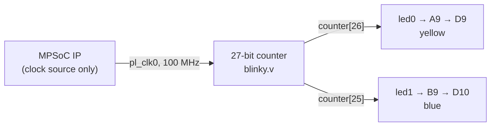

# Ultra96-V2 Blinky — PL-Only


A minimal FPGA "hello world" for the **Ultra96-V2** board. It targets only the
Zynq UltraScale+ MPSoC **Programmable Logic (PL)** fabric: two radio LEDs blink
at different rates, driven by a single free-running counter. **No PS software
and no PetaLinux are required.**

---

## Table of contents

1. [Quick start](#quick-start)
2. [Hardware](#hardware)
3. [Software](#software)
4. [Project structure](#project-structure)
5. [How it works](#how-it-works)
6. [RTL](#rtl)
7. [Pin mapping and constraints](#pin-mapping-and-constraints)
8. [Build](#build)
9. [Programming the board](#programming-the-board)
10. [Expected result](#expected-result)
11. [Customizing the blink rate](#customizing-the-blink-rate)
12. [Troubleshooting](#troubleshooting)
13. [Notes](#notes)

---

## Quick start

1. Open `project_blinkky.xpr` in Vivado.
2. **Run Bitstream** (Synthesis → Implementation → Bitstream).
3. Power the board (12 V), connect micro-USB (JTAG), and program
   `design_1_wrapper.bit`.
4. The yellow LED (D9) and blue LED (D10) start blinking right away.

---

## Hardware

| Item | Notes |
|------|-------|
| Ultra96-V2 board | Zynq UltraScale+ MPSoC (`xczu3eg-sbva484-1-i`) |
| 12 V DC power supply | Barrel jack |
| USB micro cable | For JTAG programming |

## Software

| Item | Version |
|------|---------|
| Xilinx Vivado | 2024.1 or newer |
| Avnet Ultra96-V2 Board Definition Files (BDF) | Latest from the [Avnet GitHub](https://github.com/Avnet/Ultra96-V2-Board-Definition-Files) |

> **Tip:** install the BDF before opening the project, otherwise Vivado cannot
> apply the board preset and Block Automation will be unavailable.

---

## Project structure

```text
project_blinkky/
├── project_blinkky.srcs/
│   ├── constrs_1/
│   │   └── new/
│   │       └── blinky.xdc                  # Pin constraints (A9, B9)
│   └── sources_1/
│       └── bd/
│           └── design_1/
│               └── hdl/
│                   └── design_1_wrapper.v  # Auto-generated wrapper
├── project_blinkky.gen/
│   └── sources_1/
│       └── bd/
│           └── design_1/
│               └── synth/
│                   └── design_1.v          # Block design HDL
├── project_blinkky.runs/
│   ├── synth_1/
│   └── impl_1/
│       └── design_1_wrapper.bit            # Final bitstream
└── blinky.v                                # RTL source (top-level module)
```

---

## How it works

The MPSoC IP block is in the design only to provide a clock. Its `pl_clk0`
output (100 MHz) feeds a 27-bit counter in the fabric, and the two top bits of
the counter drive the LEDs directly.



Bit *N* of a free-running counter toggles every 2<sup>N</sup> clock cycles, so
each bit is a clock divider by 2<sup>N+1</sup>:

```text
f_blink = f_clk / 2^(N+1)
```

| Signal | Counter bit | Toggles every | Full period | Blink rate |
|--------|-------------|---------------|-------------|------------|
| `led0` | 26 | 2²⁶ = 67,108,864 cycles ≈ 0.67 s | ≈ 1.34 s | ≈ 0.75 Hz |
| `led1` | 25 | 2²⁵ = 33,554,432 cycles ≈ 0.34 s | ≈ 0.67 s | ≈ 1.5 Hz |

`led1` is exactly twice as fast as `led0` because it taps the next bit down.

---

## RTL

`blinky.v` — 27-bit free-running counter; bit 26 drives LED0, bit 25 drives LED1.

```verilog
module blinky (
    input  clk,
    output led0,
    output led1
);
    reg [26:0] counter;

    always @(posedge clk)
        counter <= counter + 1'b1;

    assign led0 = counter[26];  // ~0.75 Hz
    assign led1 = counter[25];  // ~1.5 Hz
endmodule
```

---

## Pin mapping and constraints

| Port | FPGA pin | Board LED | Color | Rate |
|------|----------|-----------|-------|------|
| `led0` | A9 | D9 | Yellow | ~0.75 Hz |
| `led1` | B9 | D10 | Blue | ~1.5 Hz |

**I/O standard:** `LVCMOS18` (Bank 26)

For reference, the constraints in `blinky.xdc` take this form (the clock comes
from the block design, so it needs no pin constraint):

```tcl
set_property PACKAGE_PIN A9 [get_ports led0]
set_property PACKAGE_PIN B9 [get_ports led1]
set_property IOSTANDARD LVCMOS18 [get_ports {led0 led1}]
```

---

## Build

### GUI

1. Open Vivado → **File → Open Project** → select `project_blinkky.xpr`.
2. In Project Navigator, right-click the project → **Run Bitstream**.
3. This runs **Synthesis → Implementation → Bitstream**.
4. Output: `project_blinkky.runs/impl_1/design_1_wrapper.bit`

### Command line (optional)

```tcl
open_project project_blinkky.xpr
launch_runs impl_1 -to_step write_bitstream -jobs 4
wait_on_run impl_1
```

Run it with `vivado -mode batch -source build.tcl`.

---

## Programming the board

1. Connect the Ultra96-V2 to the PC with a micro-USB cable (JTAG).
2. Power the board (12 V).
3. In Vivado: **Open Hardware Manager → Open Target → Auto Connect**.
4. Right-click the device → **Program Device** → select `design_1_wrapper.bit`.
5. Confirm. The LEDs should begin blinking immediately.

---

## Expected result

| LED | Color | Blink rate |
|-----|-------|------------|
| D9 | Yellow | ~0.75 Hz (toggle every ~0.67 s) |
| D10 | Blue | ~1.5 Hz (toggle every ~0.33 s) |

---

## Customizing the blink rate

Change which counter bit drives each LED. The counter is 27 bits wide
(`[26:0]`), so bit 26 is the slowest rate available at a 100 MHz clock.

| Bit | Blink rate (100 MHz clock) |
|-----|----------------------------|
| 26 | ≈ 0.75 Hz |
| 25 | ≈ 1.5 Hz |
| 24 | ≈ 3.0 Hz |
| 23 | ≈ 6.0 Hz |
| 22 | ≈ 12 Hz |

For a slower blink, widen the counter, e.g. `reg [27:0] counter;` and use
`counter[27]` for ≈ 0.37 Hz.

---

## Troubleshooting

| Symptom | Likely cause and fix |
|---------|----------------------|
| Hardware Manager shows no target | Check the micro-USB cable and board power, then press **Refresh Device** or reconnect JTAG. |
| Device appears but programming fails | Select the PL device (the `xczu3` entry), not the PS/ARM DAP entry. |
| Block Automation or the board preset is missing | The Avnet BDF is not installed; install it and restart Vivado. |
| LEDs stay off after programming | Confirm the `.bit` is from the latest `impl_1` run and that the constraints use `LVCMOS18` on pins A9 and B9. |
| Clock validation errors | Make sure `maxihpm0_fpd_aclk` and `maxihpm1_fpd_aclk` are tied to `pl_clk0` (see Notes). |

---

## Notes

- The PS (ARM cores) is **not programmed** in this design. The MPSoC IP is
  included in the block design solely to provide `pl_clk0` (100 MHz) and
  board-level MIO configuration via Block Automation.
- `maxihpm0_fpd_aclk` and `maxihpm1_fpd_aclk` are tied to `pl_clk0` to satisfy
  clock validation (no AXI HP master is used).
- No reset is applied to the counter; it begins toggling within a few cycles of
  configuration.
